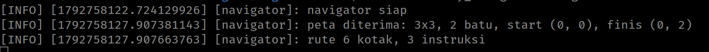
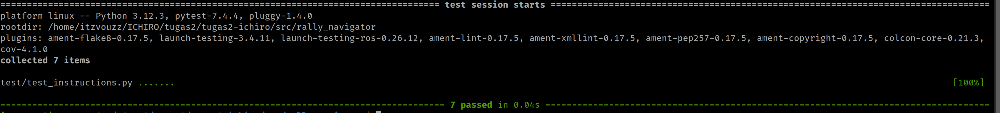
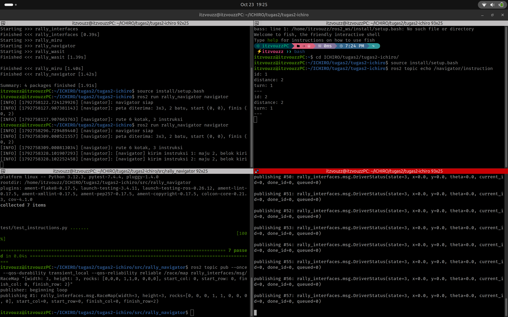
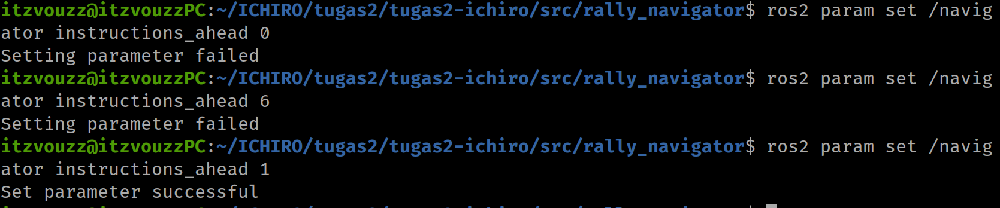
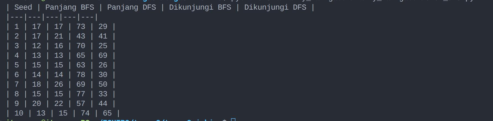

<div align=center>

|    NRP     |           Nama             | Bagian             |
| :--------: |       :------------:       | :----------------: |
| 5025261149 | Fathir Kusuma Agung W.     | Miru               |
| 5053261013 | Keijiro Majesta Arthawan   | Navigator          |

# Tugas ROS2 - Reli Miru

</div>

### Daftar Soal

- [Task 1 - Persiapan ](#soal-task-1--persiapan)

- [Task 2 - Miru](/src/rally_miru/README.md)

- [Task 3 - Navigator](/src/rally_navigator/README.md)

---

# Soal Task 1 : Persiapan

Lomba reli kolam kembali digelar! Kali ini, Miru yang hanya fokus menatap ke depan harus melintasi jalur penuh batu tersembunyi. Karena tidak bisa melihat rintangan di depannya, Miru ditemani oleh seorang Coach sebagai navigator yang memegang peta, mencari jalur terbaik, dan membacakan instruksi (seperti "maju 3, belok kanan"). Miru bertugas mengeksekusi instruksi tersebut sambil terus melaporkan posisinya. Tim yang berhasil mencapai garis finis paling cepat dengan penalti paling sedikit akan keluar sebagai pemenang.

Tugas ini dikerjakan secara berpasangan dengan pembagian peran sebagai berikut:
- Task 2: Mengimplementasikan program untuk Miru.
- Task 3: Mengimplementasikan program untuk Navigator.

### Catatan Teknis

Program wasit (grader) sudah disediakan dan tidak boleh diubah. Kalian cukup melengkapi bagian kode yang ditandai dengan komentar TODO: TASK X pada kerangka kode yang telah diberikan.

## Deskripsi Sistem

```
.
├── README.md                       # soal Task 1 dan laporan praktikum
└── src
    ├── rally_interfaces            # pesan bersama
    │   └── msg/{Instruction,DriverStatus,RaceMap,RaceState}.msg
    ├── rally_wasit                 # node wasit
    ├── rally_miru                  # node miru
    │   ├── README.md               # soal Task 2
    │   ├── rally_miru/instruction_queue.py
    │   ├── rally_miru/motion.py
    │   ├── rally_miru/node/miru_node.py
    │   └── test/test_queue.py, test_forward.py, test_turn.py
    └── rally_navigator             # node navigator
        ├── README.md               # soal Task 3
        ├── rally_navigator/grid.py
        ├── rally_navigator/route.py
        ├── rally_navigator/node/navigator_node.py
        └── test/test_find_route.py, test_directions.py, test_instructions.py
```

Miru hanya mengedit `instruction_queue.py`, `motion.py`, dan `miru_node.py`. Navigator hanya mengedit `route.py` dan `navigator_node.py`. Bagian pada kode yang bertanda `Provided, do not modify` jangan diubah, termasuk seluruh package `rally_wasit` dan semua file tes.

### Aturan Lomba

- **Lintasan:** grid 10 × 10 kotak, tiap kotak 1 m. Pusat kotak (kolom `c`, baris `r`) ada di koordinat turtlesim `(c + 1, r + 1)`. Baris 0 di bawah, kolom 0 di kiri.
- **Batu:** sekitar 25 persen kotak. Ada satu kotak start di kolom 0 dan satu kotak finis di kolom 9. Lintasan dibuat acak dari parameter `seed` milik wasit, dan selalu ada jalan dengan rute terpendek minimal 12 kotak.
- **Wasit** menggambar batu (kotak merah bersilang), start (kotak biru), dan finis (kotak hijau) di kanvas turtlesim, lalu memindahkan Miru ke kotak start menghadap timur.
- **Miru tidak boleh membaca peta** dan **navigator tidak boleh membaca posisi kura-kura langsung**. Kedua node hanya boleh saling tahu lewat instruksi dan laporan. Wasit memeriksa siapa saja yang subscribe, dan mencetak `CURANG` Jika ada yang melanggar.
- Wasit menunggu Miru menyala, lalu hitung mundur 3 detik, lalu `GO!`. Wasit tidak menunggu navigator, jadi **nyalakan navigator sebelum perintah `GO!`**. Navigator yang menyala terlambat akan menyebabkan Miru sudah maju sendiri, sehingga rute dari kotak start tidak cocok lagi dengan posisinya dan lombanya bisa gagal.
- Gerakan Miru hanya dua macam: **maju lurus** sekian kotak, dan **belok 90°** di tempat ke kiri atau kanan.
- **Penalti** (ditambahkan ke waktu):

| Kejadian | Akibat |
|---|---|
| Miru bergerak sebelum `GO` | +10 detik |
| Pusat Miru masuk kotak batu | +5 detik per batu |
| Miru keluar dari grid | lomba gagal |
| Belum finis setelah 120 detik | lomba gagal |
| Pusat Miru masuk kotak finis | waktu berhenti |

### Spesifikasi Bersama

**Instruksi.** Satu `Instruction` berarti: *maju sebanyak `distance` kotak dulu, lalu belok `turn`*. `distance` boleh 0, dan instruksi terakhir memakai `TURN_NONE`. Contoh rute di peta kecil:

```
maju 3, belok kanan     {id: 1, distance: 3, turn: TURN_RIGHT}
maju 2, belok kiri      {id: 2, distance: 2, turn: TURN_LEFT}
maju 4, selesai         {id: 3, distance: 4, turn: TURN_NONE}
```

Miru memulai lomba menghadap **timur**. Jika langkah pertama rute bukan ke timur, instruksi pertama hanya berisi belokan (`distance: 0`). Putar balik 180° ditulis dua belokan kiri berturut-turut dengan `distance: 0`.

**Arah.** Empat arah berurutan berlawanan jarum jam: timur (+kolom), utara (+baris), barat, selatan. Susunan ini sudah ada di `grid.py` sebagai `DIRECTION_COL` dan `DIRECTION_ROW`.

**Urutan tetangga di BFS** harus timur, utara, barat, selatan, supaya peta yang sama selalu menghasilkan rute yang sama.

**Pengiriman instruksi.**

1. Navigator baru mengirim setelah ada rute, Miru sudah melapor sekali, dan ada yang subscribe topic instruksi. Pesan yang dikirim sebelum itu hilang.
2. Navigator menjaga `instructions_ahead` instruksi di depan `done_id`. Dengan nilai 2 dan `done_id = 4`, instruksi 5 dan 6 sudah harus terkirim.
3. Jika antrean Miru kosong, Miru berhenti menunggu (`WAITING_INSTRUCTION`). Jika tidak ada navigator sama sekali, Miru maju lurus ke arah hadapnya.
4. Miru menjalankan instruksi **berurutan menurut `id`**. Instruksi dengan `id` yang sama atau lebih kecil dari yang sudah diterima diabaikan.

### Antarmuka

| Apa | Nama | Tipe | Pengirim | Penerima |
|---|---|---|---|---|
| Peta lintasan | `/race/map` | `rally_interfaces/msg/RaceMap` | wasit | navigator |
| Status lomba | `/race/state` | `rally_interfaces/msg/RaceState` | wasit | miru |
| Instruksi| `/navigator/instruction` | `rally_interfaces/msg/Instruction` | navigator | miru |
| Laporan Miru | `/miru/status` | `rally_interfaces/msg/DriverStatus` | miru | navigator |
| Posisi kura-kura | `/turtle1/pose` | `turtlesim/msg/Pose` | turtlesim | miru dan wasit |
| Perintah gerak | `/turtle1/cmd_vel` | `geometry_msgs/msg/Twist` | miru | turtlesim |
| Kecepatan maju | parameter `speed`, bawaan 1,0 m/s, rentang 0,1 sampai 2,5 | double | operator | miru |
| Instruksi dikirim lebih dulu | parameter `instructions_ahead`, bawaan 2, rentang 1 sampai 5 | integer | operator | navigator |
| Seed lintasan | parameter `seed`, bawaan -1 (acak) | integer | operator | wasit |
| Waktu hitung mundur, batas waktu | parameter `countdown` (3,0 s), `time_limit` (120,0 s) | double | operator | wasit |

`ros2 interface show rally_interfaces/msg/DriverStatus` menampilkan isi tiap pesan lengkap dengan konstantanya.

### Contoh Output Lomba

Dengan `seed:=7`. Angka waktu boleh berbeda beberapa detik. Masing-masing node mencetak keluarannya di terminalnya sendiri.

#### Wasit:
```
[wasit] lintasan seed 7: start (0, 1), finis (9, 2), rute terpendek 18 kotak
[wasit] 3...
[wasit] 2...
[wasit] 1...
[wasit] GO!
[wasit] finish 27.3 s + penalti 0 s = 27.3 s
```

#### Miru:
```
[miru] instruksi 1: maju 0, belok kiri
[miru] instruksi 2: maju 2, belok kanan
[miru] instruksi 3: maju 2, belok kiri
...
[miru] instruksi 8: maju 4, finis
```

#### Navigator:
```
[navigator] peta diterima: 10x10, 27 batu, start (0, 1), finis (9, 2)
[navigator] rute 18 kotak, 8 instruksi
[navigator] kirim instruksi 1: maju 0, belok kiri
[navigator] kirim instruksi 2: maju 2, belok kanan
[navigator] kirim instruksi 3: maju 2, belok kiri
...
[navigator] kirim instruksi 8: maju 4, finis
```

Awalan ROS (`[INFO]` dan timestamp) dihilangkan dengan `export RCUTILS_CONSOLE_OUTPUT_FORMAT='[{name}] {message}'`, yang dijalankan sekali di setiap terminal.

## Soal (_Tasks_)

### A. Setup Workspace _(5 Points)_

Build workspace, jalankan keempat node, lalu buktikan semuanya terhubung.

```bash
source /opt/ros/jazzy/setup.bash
colcon build --symlink-install
source install/setup.bash

export RCUTILS_CONSOLE_OUTPUT_FORMAT='[{name}] {message}'   # di setiap terminal

# terminal 1
ros2 run turtlesim turtlesim_node
# terminal 2
ros2 run rally_wasit wasit --ros-args -p seed:=7
# terminal 3
ros2 run rally_navigator navigator
# terminal 4
ros2 run rally_miru miru
```

Dengan `--symlink-install`, perubahan kode Python langsung berlaku tanpa `colcon build` ulang, node cukup dijalankan ulang.

#### Contoh Output:
```
[wasit] wasit siap
[navigator] navigator siap
[miru] miru siap
[wasit] menunggu miru...
```

Kanvas turtlesim terisi batu, start, dan finish, dan `rqt_graph` menampilkan keempat node.

Note : Di kerangka awal, wasit akan terus mencetak `menunggu miru...`, karena lomba baru dimulai setelah Miru memasang publisher laporannya (Task 2). Wasit tidak menunggu navigator untuk memulai permainan. Akibatnya Miru maju lurus ke timur dan lomba tetap dinilai. Jalankan `source install/setup.bash` di setiap terminal baru.

## Berkas Pengumpulan

1. Repositori yang berisi source code dari `rally_miru` dan `rally_navigator` yang sudah dilengkapi.
2. `README.md` di root dengan laporan yang sudah diisi, beserta folder `screenshots/`.
3. **Penggunaan AI diperbolehkan**, namun harus dinyatakan dengan jelas untuk apa dan bagian mana yang ditulis menggunakan bantuan AI.

## Tips Umum

- Jalankan wasit dengan `-p seed:=7` supaya lintasannya sama setiap kali, dan coba banyak seed sebelum yakin.
- Nama topic dan parameter sudah tersedia sebagai konstanta di bagian atas file (`..._TOPIC`, `..._PARAM`). Jadi kalian bisa memanfaatkan konstanta itu.
- `ros2 node list`, `ros2 topic list`, dan `ros2 param list` memberi tahu apa saja yang sebenarnya berjalan.

---

### Laporan Resmi Praktikum

Tulis laporan di template berikut! Tidak perlu terlalu teknis sampai kode atau nama fungsi, cukup jelaskan dengan kalimat sendiri.

Penggunaan AI: (sebutkan bagian mana yang dibantu AI, atau tulis "tidak ada")

---

# Task 1 - Persiapan dan Lomba

## A. Setup Workspace

### Langkah-langkah
```
source /opt/ros/jazzy/setup.bash
colcon build --symlink-install
source install/setup.bash

export RCUTILS_CONSOLE_OUTPUT_FORMAT='[{name}] {message}'   # di setiap terminal

# terminal 1
ros2 run turtlesim turtlesim_node
# terminal 2
ros2 run rally_wasit wasit --ros-args -p seed:=7
# terminal 3
ros2 run rally_navigator navigator
# terminal 4
ros2 run rally_miru miru
```

-

### Screenshot


# Task 2 - Miru

## A. Antrean Instruksi

### Langkah-langkah
- Pada def `add` antrean dibuat dengan instruksi yang datang lebih dulu dijalankan lebih dulu(FIFO). Antrean menerima id instruksi paling besar. id akan dibandingkan dengan yang lama jika lebih kecil atau sama maka tidak diterima
- Kemudian dibuat juga `pop` untuk mengambil antrean terlama, dan `__len__` untuk menghitung jumlah antrean
- Di `miru_node`, subscribe ke topic `Instruction`. Setiap pesan yang masuk dimasukkan ke antrean dan masuk ke fungsi `on_instruction`. Jika diterima, dicatat di log. Jika diabaikan, hanya muncul di log debug.
- Dites dengan mengirim instruksi id 1 dua kali lewat `ros2 topic pub`, dan lognya hanya muncul sekali. Tes `test_queue.py` juga dijalankan.

-

### Screenshot
Masukkan screenshot hasil eksekusi program atau proses yang relevan.

## B. Pose dan Perintah Gerak

### Langkah-langkah
- Buat publisher ke `/turtle1/cmd_vel` untuk menggerakkan kura-kura. Kecepatan maju dan kecepatan putar dikirim lewat satu pesan `Twist`.
- Buat subscriber ke `/turtle1/pose`. Setiap pose baru disimpan sebagai pose terbaru, sehingga Miru selalu tahu posisi dan arah kura-kura.
- Kemudian pose terbaru akan disimpan di `self.pose` melalui `on_pose` dan membuat `publish_velocity` untuk mengirim pergerakan ke kura-kura
- Hasilnya dicek dengan `ros2 node info /miru`. Di situ muncul subscriber `/turtle1/pose` dan publisher `/turtle1/cmd_vel`.

-

### Screenshot
Masukkan screenshot hasil eksekusi program atau proses yang relevan.

## C. Aba-aba GO dan Parameter

### Langkah-langkah
- Parameter `speed` di inisiasi dengan nilai awal 1,0 m/s. dan bisa diubah di `on_parameter_change`. Setiap ada permintaan mengubah `speed`, nilainya akan diperiksa dulu. Jika di luar rentang 0,1 sampai 2,5, perubahan ditolak.
- Miru subscribe ke `/race/state` dan menyimpan status lomba terbaru. Miru baru mulai menjalankan instruksi setelah statusnya `GO` yang akan disimpan di `on_race_state`.
- Buat juga `get_speed` untuk mengambil parameter speed saat ini.
- Dites dengan `ros2 param set /miru speed 3.0` (ditolak), `0.05` (ditolak), dan `2.5` (diterima).

-

### Screenshot
Masukkan screenshot hasil eksekusi program atau proses yang relevan.

## D. Maju

### Langkah-langkah
- Di `motion.py`, buat fungsi `target_point` untuk mencari tahu koordinat x,y dari perintah bergerak yang diberikan, dengan rumus: posisi + jumlah kotak × arah hadap.
- Kemudian buat `remaining_distance` untuk melihat jarak yang tersisa setelah mendekati koordinat dan Nilainya positif jika tujuan masih di depan, dan nol atau negatif jika sudah sampai atau terlewat.
- Di `miru_node.py` buat fungsi `start_drive` untuk menyimpan tujuan koordinat dari `target_point`.
- Kemudian `drive_step`, kura-kura akan terus maju sambil jaraknya di cek dengan`remaining_distance`. jika nilai sisa jarak <= 0, maka kura-kura akan berhenti.
- Dites dengan GO palsu dan instruksi maju 3. Kura-kura maju sekitar 3 m ke timur lalu berhenti, dan `test_forward.py` lulus.

-

### Screenshot
Masukkan screenshot hasil eksekusi program atau proses yang relevan.

## E. Belok

### Langkah-langkah
- Di `motion,py` hitung Arah tujuan di `turn_target`, belok kiri = + 90 derajat dan belok kanan = - 90 derajat (phi = 180, phi/2 = 90). Hasilnya dirapikan dengan `wrap_angle` supaya tetap di antara -phi dan phi.
- Di `motion_node.py` buat fungsi `start_turn` untuk menyimpan nilai belok sesuai dengan `planned_heading`
- Kemudian di `turn_step` hitung selisih antara arah tujuan dan arah sekarang. Selisih itu diberikan ke fungsi `turn_rate` untuk mendapat kecepatan putar.
- Jika `turn_rate` bernilai 0 (selisih sudah cukup kecil), Miru berhenti dan belokan selesai, jika > 0 maka memanggil `publish_velocity` untuk berputar.
- Dites dengan GO palsu, lalu belok kiri dan belok kanan. Nilai `theta` pada pose sekitar 1,57 setelah belok kiri dan sekitar 0 setelah belok kanan. `test_turn.py` lulus.

-

### Screenshot
Masukkan screenshot hasil eksekusi program atau proses yang relevan.

## F. Laporan Status

### Langkah-langkah
- Buat publisher ke `/miru/status` yang berisi `DriverStatus` dan timer yang memanggil fungsi laporan dari `STATUS_PERIOD` = 0,05 detik (20 kali per detik).
- Setiap laporan berisi state Miru, posisi, arah, id instruksi yang sedang dijalankan, id instruksi terakhir yang selesai, dan jumlah instruksi di antrean.
- Laporan tidak dikirim sebelum pose pertama dari turtlesim diterima, karena itu menggunakan if dan akan di return .. (kosong)
- Dicek dengan `ros2 topic hz /miru/status` (sekitar 20 Hz) dan `ros2 topic echo /miru/status` untuk melihat isinya.

-

### Screenshot
Masukkan screenshot hasil eksekusi program atau proses yang relevan.

## G. Bonus: Berhenti Lebih Tepat

### Langkah-langkah
- Pertama buat `USE_SLOWDOWN` sebagai kondisi kapan memakai slowdown dan dieksekusi menggunakan if.
- Buat `SLOWDOWN_MIN` sebagai batas kecepatan paling minimal yang harus dimiliki kura-kura agar tidak berhenti ditengah-tengah. Disini di inisialisasi dengan 0.15
- Buat `SLOWDOWN_CONS` atau konstantan slowdown yang akan digunakan sebagai pengali dengan sisa jarak yang ada. Sehingga semakin kecil sisa jarak = semakain kecil kecepatannya hingga nanti dibatasi oleh `SLOWDOWN_MIN`.
- Terakhir masukkan dalam `drive_step` dengan cara kerja, jika `USE_SLOWDOWN` = True maka speed yang digunakan adalah speed paling minimal dari `speed` dan `sisa(jarak) * SLOWDOWN_CONS`. Karena ada kemungkinan `sisa(jarak) * SLOWDOWN_CONS` bernilai sangat kecil, batasi dengan menggunakan fungsi max dengan `SLOWDOWN_MIN`.

-

| Kecepatan | Galat lama | Waktu lama | Galat baru | Waktu baru |
|---|---|---|---|---|
| 0,5 m/s | 0.50404 m | 6.90 s | 0.47201 m | 7.23 s |
| 1,0 m/s | 0.55204 m | 3.45 s | 0.47152 m | 3.98 s |
| 2,5 m/s | 0.72004 m | 1.39 s | 0.47038 m | 2.12 s |

### Screenshot
Masukkan screenshot hasil eksekusi program atau proses yang relevan, termasuk tabel hasil ukur.

# Task 3 - Navigator

## A. Menerima Peta

### Langkah-langkah
*   Menambahkan `QoSProfile` dengan jenis `TRANSIENT_LOCAL` dan `RELIABLE` pada *subscriber* peta agar pesan tidak hilang[cite: 2].
*   Membuat validasi pada *callback* `on_map` untuk menolak peta jika ukuran *array* batu tidak sesuai dengan `width * height`[cite: 2].
*   Menyimpan data pesan yang valid ke dalam objek `GridMap` dan memanggil fungsi pencarian rute[cite: 3].

### Screenshot


## B. Mencari Rute

### Langkah-langkah
*   Mengimplementasikan algoritma *Breadth-First Search* (BFS) menggunakan objek `deque`[cite: 4].
*   Melakukan iterasi pengecekan kotak tetangga dengan urutan prioritas: Timur, Utara, Barat, lalu Selatan[cite: 2].
*   Mengabaikan kotak yang berada di luar batas peta atau berisi batu, lalu mencatat jalur pada *dictionary* `parent` hingga mencapai finis[cite: 4].

### Screenshot


## C. Rute Menjadi Arah

### Langkah-langkah
*   Melakukan iterasi pada *list* kotak (*route*) yang dihasilkan dari fungsi BFS[cite: 2].
*   Menghitung selisih koordinat (baris dan kolom) antara kotak saat ini dan kotak selanjutnya[cite: 13].
*   Mencocokkan hasil selisih tersebut dengan konstanta arah untuk menghasilkan *list* berisi angka arah (0=Timur, 1=Utara, 2=Barat, 3=Selatan)[cite: 13].

### Screenshot


## D. Arah Menjadi Instruksi

### Langkah-langkah
*   Mengonversi *list* angka arah menjadi pesan `Instruction` yang berisi jarak maju dan jenis belokan[cite: 2, 14].
*   Menambahkan logika *modulo* untuk mendeteksi belokan, dengan penanganan khusus untuk kura-kura yang selalu mulai menghadap Timur[cite: 14].
*   Memecah kondisi putar balik menjadi dua instruksi belok kiri, dan menutup instruksi paling akhir dengan `TURN_NONE`[cite: 2, 14].

### Screenshot


## E. Mengirim Instruksi

### Langkah-langkah
*   Mendaftarkan *publisher* untuk topik instruksi dan *subscriber* untuk membaca laporan status dari Miru[cite: 16].
*   Membuat pembatasan pengiriman instruksi (*looping*) berdasarkan ID instruksi yang sudah diselesaikan Miru (`done_id`) ditambah batas *ahead*[cite: 2, 16].
*   Menambahkan validasi untuk memastikan instruksi baru dikirim jika jumlah *subscriber* lebih dari nol (Miru sudah menyala)[cite: 16].

### Screenshot


## F. Parameter instructions_ahead

### Langkah-langkah
*   Mendaftarkan parameter `instructions_ahead` menggunakan `declare_parameter` agar nilai batas instruksi menjadi dinamis[cite: 17].
*   Mengubah fungsi pengiriman instruksi agar mengambil nilai batas langsung dari parameter, bukan lagi dari konstanta statis[cite: 2, 17].
*   Membuat *callback* validasi untuk menolak perubahan parameter jika nilainya berada di luar rentang 1 sampai 5[cite: 2, 17].

### Screenshot


## G. Bonus: DFS lawan BFS

### Langkah-langkah
*   Membuat fungsi `find_route_dfs` menggunakan objek *List* sebagai tumpukan (*Stack* / LIFO)[cite: 2].
*   Membalikkan urutan iterasi pengecekan arah (dari Selatan ke Timur) agar arah Timur diekstrak pertama kali dari *stack*.
*   Membuat skrip Python terpisah untuk membandingkan perbedaan panjang rute dan jumlah kotak yang dikunjungi antara BFS dan DFS.
*   Menjalankan perlombaan ROS 2 menggunakan rute BFS dan DFS secara bergantian untuk mencatat perbedaan waktu tempuhnya.

### Hasil Analisis dan Tabel

| Seed | Panjang BFS | Panjang DFS | Dikunjungi BFS | Dikunjungi DFS | Waktu BFS | Waktu DFS |
|---|---|---|---|---|---|---|
| 7 | 18 | 26 | 69 | 50 | 30.4 s | 52.2 s |
| 9 | 20 | 22 | 57 | 44 | 34.6 s | 43.1 s |

**Analisis:**
Algoritma BFS menjamin penemuan rute terpendek sehingga kura-kura menyelesaikan lomba lebih cepat, namun mengorbankan memori karena mengevaluasi banyak kotak di peta. Sebaliknya, DFS memproses lebih sedikit kotak karena hanya fokus menelusuri satu cabang sedalam mungkin. Akibatnya, rute yang dihasilkan DFS cenderung jauh lebih panjang dan berputar-putar, yang berimbas pada waktu lomba yang jauh lebih lambat.

### Screenshot


### Screenshot
Masukkan screenshot hasil eksekusi program atau proses yang relevan, termasuk tabel hasil ukur.
